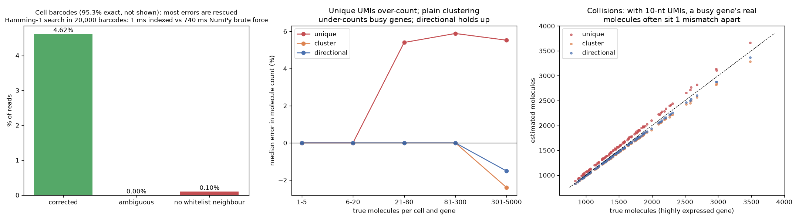

# Barcode and UMI Error Correction

> One substitution in a UMI and one molecule becomes two. Scale that over millions of reads and your counts are inflated before the first plot.

## Demo Output

Produced by `demo.py` from simulated droplet reads with sequencing errors in cell barcodes and PCR/sequencing errors in 10-nt UMIs. Left: what happens to reads whose barcode isn't on the whitelist, and how fast the indexed search is. Middle: error in molecule counts by expression level for three UMI methods. Right: one very highly expressed gene, where real UMIs start to collide.

## Why This Exists

Droplet scRNA-seq turns reads into a genes x cells matrix in three steps: correct the cell barcode, map the read to a gene, and collapse reads into molecules by UMI. Errors creep into barcodes and UMIs during bead production, PCR and sequencing.

Arcane (Zentgraf et al., *Genome Research* 2026) speeds up all three steps. It builds on Fourway, a fast way to find all k-mers one mismatch apart, and it matches Cell Ranger, kallisto|bustools and alevin-fry while running faster. This repo shows the barcode and UMI parts of that idea at small scale.

## How It Works

**Hamming-1 search.** Two strings that differ in at most one position match exactly on at least one half. So bucket every whitelist barcode by its left half and by its right half, and compare a query only with the barcodes in its two buckets. Fourway refines this with more parts. On a 20,000-barcode whitelist, this is far faster than even a vectorised NumPy scan (see the figure title for the measured times). Modern whitelists hold millions.

**Barcode correction.**
- Barcodes on the whitelist stay as they are.
- A barcode one mismatch from exactly one seen barcode is corrected to it. If several qualify, the one with the most exact reads wins.
- Ties are discarded.

**UMI resolution** within each cell and gene:
| Method | Rule | Failure mode |
|--------|------|--------------|
| unique | every distinct UMI is a molecule | error UMIs count as molecules (over-count) |
| cluster | collapse every chain of 1-mismatch UMIs | real molecules one mismatch apart merge (under-count) |
| directional (UMI-tools) | UMI *a* absorbs *b* only if they are 1 mismatch apart and reads(a) ≥ 2·reads(b) − 1 | far fewer false merges |

## What the Demo Shows

- 4.6% of reads had a barcode error. 98% of those were rescued and none went to the wrong cell.
- Unique UMIs over-count every gene with more than ~20 molecules by about 5.5%.
- On the busiest gene (≈1,500 molecules in a 10-nt UMI space), cluster under-counts by 2.4%. Directional under-counts by only 1.5%, because the read-count rule stops two healthy molecules from merging.

## When NOT to Use This

- **Real data.** Use Arcane, Cell Ranger, STARsolo, alevin-fry or kallisto|bustools. This repo skips read-to-gene mapping, base qualities and multimapping UMIs.
- **Long-read or plate-based protocols.** Their error profiles (indels, not substitutions) need edit-distance methods.

## The Uncomfortable Truth

Every correction rule trades one error for another. Directional still merges a real 1-read molecule into a 4-read neighbour, and no rule can split two molecules that drew the same UMI. If a gene's count per cell approaches the UMI space (4^10 ≈ 1M here; 4^12 ≈ 17M for 10x v3), collisions put a ceiling on accuracy that more clever code can't lift.

## Further Reading

- Zentgraf J. et al. "Error correction algorithms for efficient gene expression quantification in single cell transcriptomics with Arcane." Genome Research (2026). doi:10.1101/gr.282251.126
- Smith T., Heger A. & Sudbery I. "UMI-tools: modeling sequencing errors in Unique Molecular Identifiers to improve quantification accuracy." Genome Research (2017).
- Melsted P. et al. "Modular, efficient and constant-memory single-cell RNA-seq preprocessing." Nature Biotechnology (2021).
- He D. et al. "Alevin-fry unlocks rapid, accurate and memory-frugal quantification of single-cell RNA-seq data." Nature Methods (2022).
